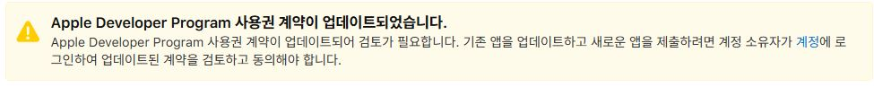
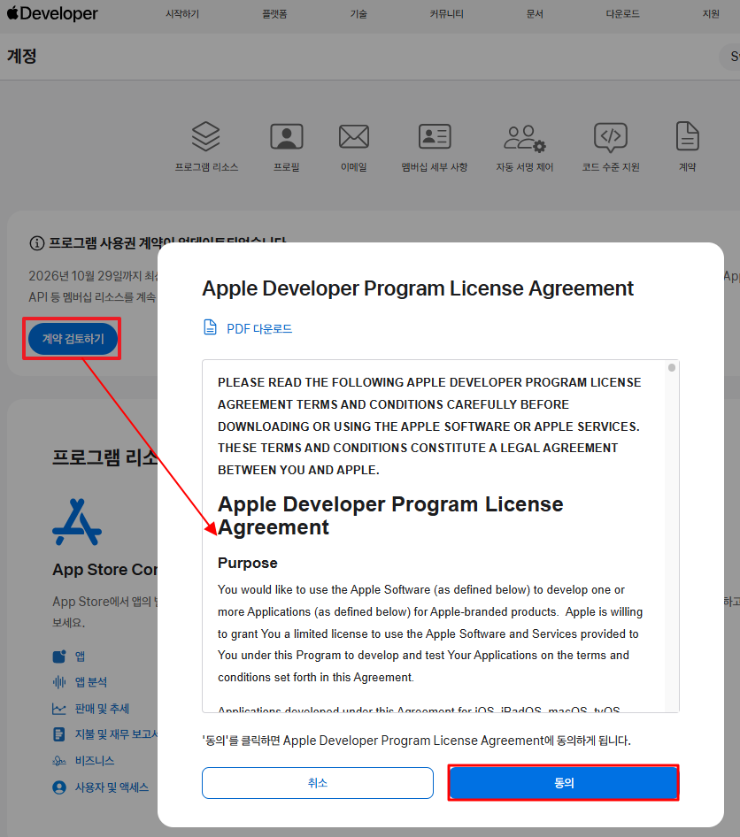
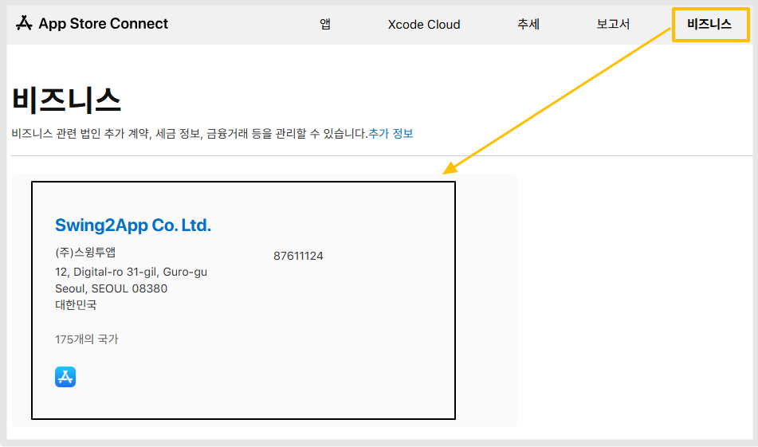
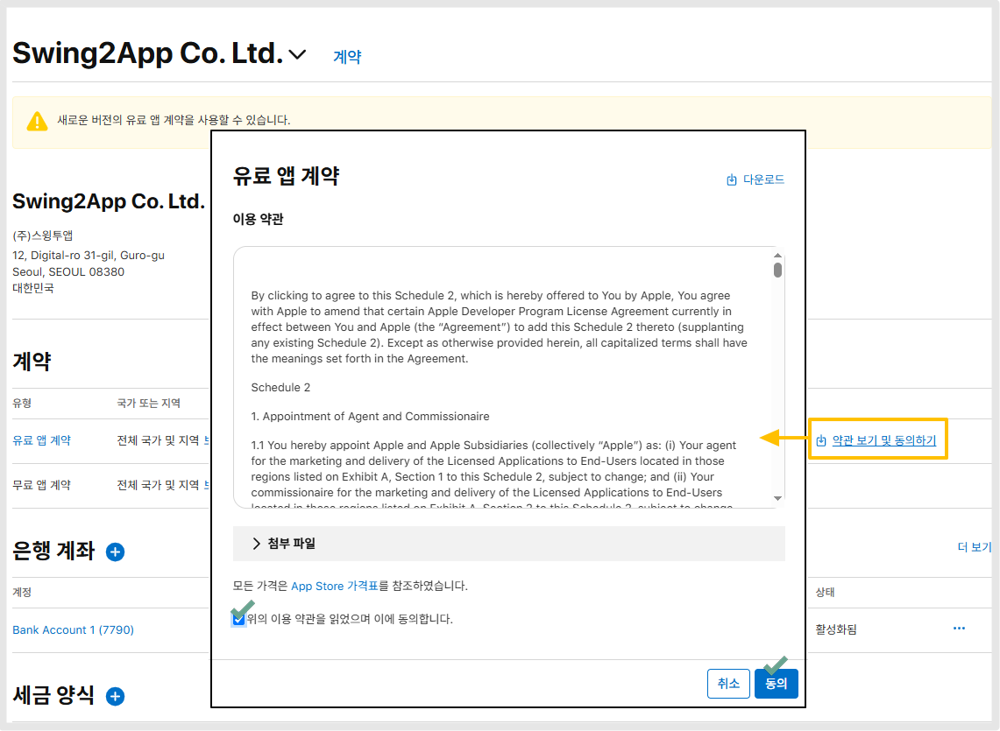
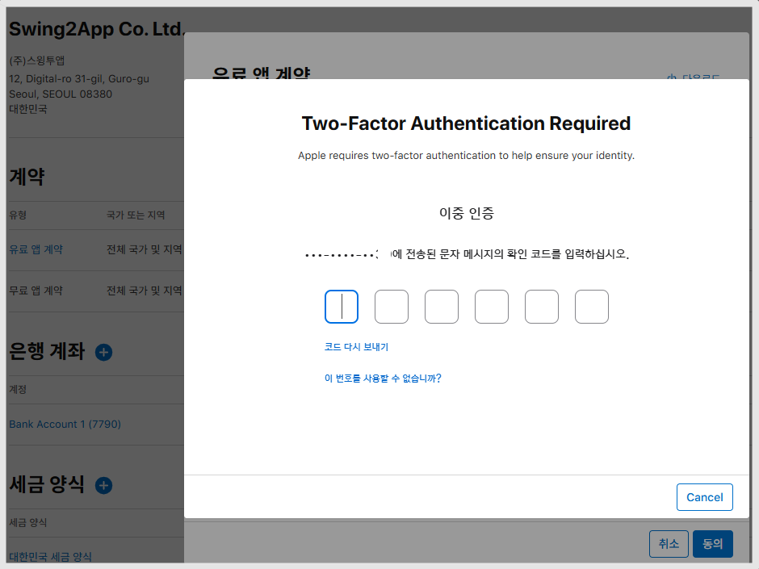

# 애플 개발자 프로그램 업데이트

***

**애플 개발자 프로그램 사용권 계약 업데이트**&#x20;

애플 개발자 계정 이용시, 주기적으로 애플 개발자 사용권 계약 업데이트에 승인(수락)을 해주셔야 합니다.&#x20;

### **1.Apple Developer Program 사용권 계약 업데이트 안내**&#x20;

<figure><figcaption></figcaption></figure>

앱스토어 커넥트 접속시 위의 이미지처럼 업데이트 안내 메시지가 떠 있는 것을 확인할 수 있습니다.&#x20;

#### <mark style="color:$primary;">**\[진행방법]**</mark>

<figure><figcaption></figcaption></figure>

[애플 개발자 사이트](https://developer.apple.com/account) 접속, 로그인 후&#x20;

\> 개발자 사이트 상단 '계정' 선택&#x20;

\> 메인 화면 상단 "프로그램 사용권 계약이 업데이트 되었습니다" 메시지 창 확인

\> 계약 검토하기 선택&#x20;

\>라이선스 계약 팝업에서 \[동의] 버튼 선택하면 완료됩니다.

***

### **2.유료앱 계약 약관 동의하기**

유료앱 판매 등을 이용하는 개발자의 경우 비즈니스에서 - 유료앱 계약 업데이트에 승인해야 합니다.&#x20;

1.앱스토어 커넥트 접속 - 비즈니스 탭 선택

[https://appstoreconnect.apple.com/](https://appstoreconnect.apple.com/)

<figure><figcaption></figcaption></figure>

**2.계약: 유료앱 계약에서 \[약관 보기 및 동의하기] 선택**

<figure><figcaption></figcaption></figure>

계약서 약관 확인 체크 후,  '동의' 버튼 선택

**3.인증번호 받기**&#x20;

<figure><figcaption></figcaption></figure>

계정에 등록된 연락처로 이중인증 코드 6자리 받아서 입력 해주세요.

화면에서 새로고침 한번 더 해주시면 인증 완료 됨을 확인할 수 있습니다.

