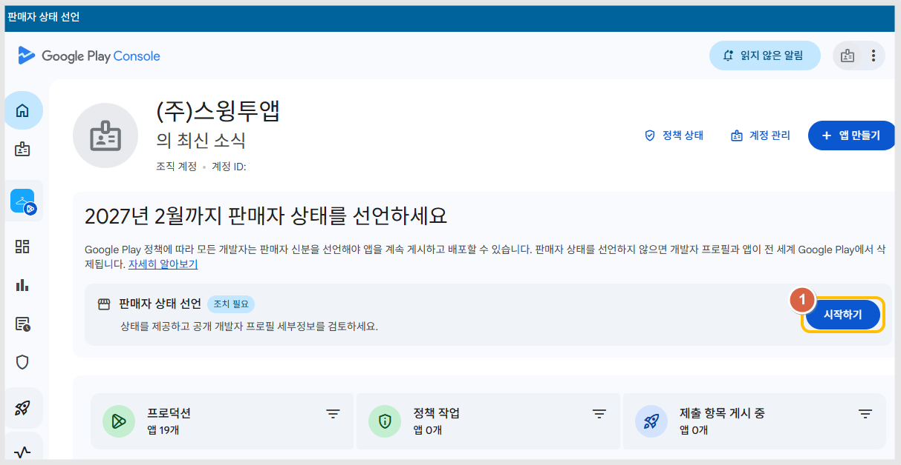
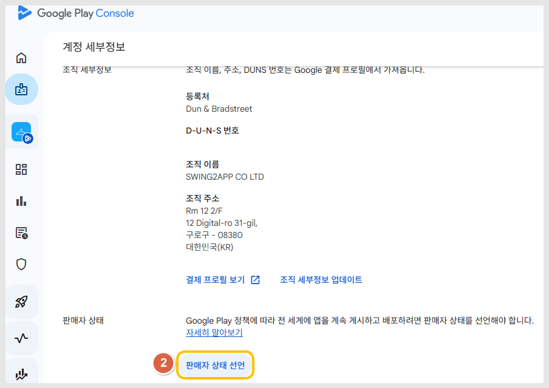
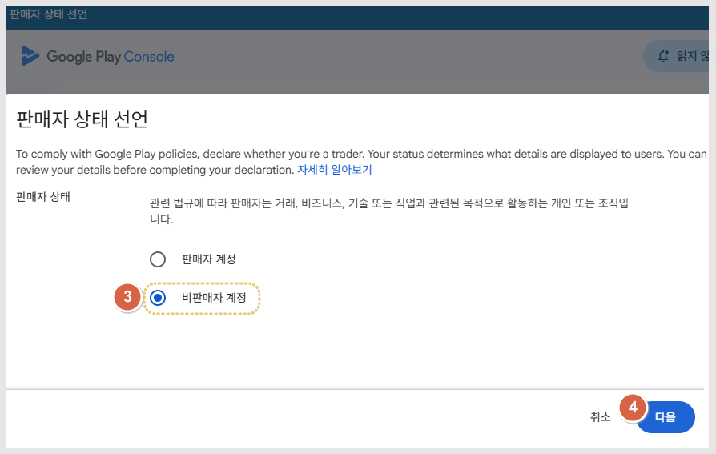
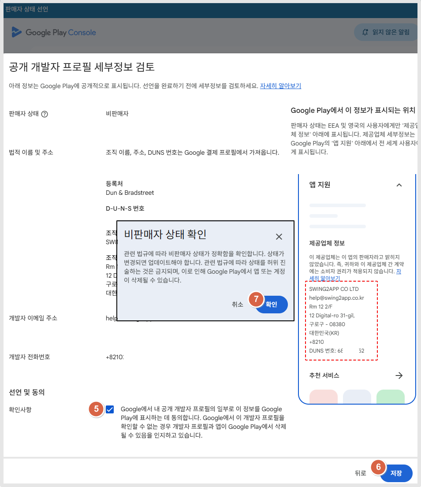
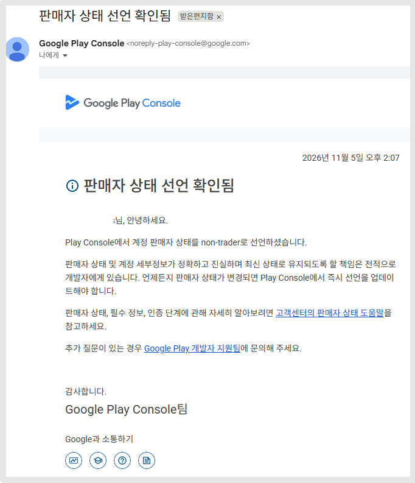

# \[필수 조치] Google Play 판매자 상태 선언-비판매자

***


**업데이트된 Google Play 정책에 따라 이제 Play Console에서 판매자인지 비판매자인지 선언해야 합니다.**

**27년 2월 1일까지 모든 구글 개발자 계정 사용자분들은 판매자 상태 선언을 완료해주세요.**


해당 가이드는 <mark style="color:$primary;">**비판매자 선언 방법**</mark> 가이드 입니다.&#x20;

## **📌비판매자 선언**

[구글 플레이콘솔](https://play.google.com/console/developers) 사이트에 접속하면, 홈화면 메인 상단에&#x20;

**"2027년 2월까지 판매자 상태를 선언하세요"** 메시지를 확인할 수 있습니다.&#x20;

<figure><figcaption></figcaption></figure>

1.판매자 상태 선언 - **시작하기** 버튼 선택

<figure><figcaption></figcaption></figure>

2.판매자 상태에서 **\[판매자 상태 선언]** 선택&#x20;

<figure><figcaption></figcaption></figure>

3.판매자 상태 선언: 비판매자 계정 선택&#x20;

4.다음 선택

<figure><figcaption></figcaption></figure>

5.확인사항에 체크해주세요.

<mark style="color:red;">\*조직 개발자 계정은, 플레이스토어앱 지원 섹션>제공업체 정보에서</mark> <mark style="color:red;"></mark><mark style="color:red;">**\*회사명, 이메일주소, 주소, 던스번호, 전화번호**</mark><mark style="color:red;">가 모두 노출됩니다.</mark>&#x20;

6.저장 선택하면 완료됩니다.&#x20;

선언이 완료되면  \[판매자 상태 선언 확인됨] 메일 들어오며, 플레이콘솔에서도 메시지창 사라집니다.&#x20;

<figure><figcaption></figcaption></figure>

***

## **💡자주 묻는 질문**

**Q. 한국에서만 앱을 운영하는데도 선언해야 하나요?**

네. 앱 배포 국가와 관계없이 모든 활성 Google Play 개발자 계정이 선언 대상입니다.&#x20;

단, EEA 및 영국에 앱을 배포하지 않는 경우는 비판매자로 선언할 수 있습니다.

**Q.무료 앱을 운영하고 있습니다. 비판매자로 선택하면 되나요?**

네  무료앱이면 "비판매자"로 선택하시면 됩니다.&#x20;

단, 무료 앱이라도 광고 등을 통해 앱에서 수익을 창출한다면 판매자로 체크해주세요.&#x20;

**Q.앱에 광고를 넣어 수익을 얻고 있습니다. 판매자로 선택해야 하나요?**

광고를 통해 정기적 또는 상업적으로 수익을 얻는 경우 판매자로 체크합니다.&#x20;

Google은 광고 수익을 판매자 판단 기준 중 하나로 안내하고 있습니다.

**Q. 판매자로 선언하면 추가로 해야 할 일이 있나요?**

네. 법규 준수에 대한 자체 인증과 앱별 판매자 상태 확인이 필요합니다.&#x20;

앱 별로 앱컨텐츠에서 판매자 상태 적용을 각각 해주셔야 합니다.&#x20;

**Q. 판매자로 선언하면 어떻게 되나요? Play 스토어에서 사용자에게 표시되는 다른 항목은 무엇인가요?**

판매자로 선언하면 현지 법규를 준수하는 제품 또는 서비스를 제공할 것을 약속하는 자체 인증을 진행하라는 메시지가 표시됩니다.

2027년 3월 1일부터 전 세계 사용자에게 다음과 같은 내용이 표시됩니다.

* **연락처 정보**: 연락처 정보가 표시됩니다. 특히 개인 계정이 있고 판매자인 경우 이제 전화번호와 주소가 표시됩니다.
* **DUNS 번호**: DUNS 번호가 '앱 지원' 섹션에 표시됩니다. (조직 개발자의 계정)
* **서비스 약관**: 앱의 서비스 약관 링크입니다(제공한 경우).

2027년 3월 1일부터 EEA 및 영국 사용자에게는 다음과 같은 내용도 표시됩니다.

* **개발자 이름**: '앱 정보' 섹션의 '판매자 이름' 입력란에 Google 대신 개발자 이름/상호가 표시됩니다.
* **자체 인증**: 현지 법규를 준수하는 제품 또는 서비스를 제공하겠다는 약속이 표시됩니다.

**Q. 여러 개의 앱을 운영하고 있는데, 앱마다 선언해야 하나요?**

네, 먼저 개발자 계정에서 판매자 상태를 선언해야 합니다.

판매자로 선언한 경우에는 등록된 앱별로 판매자 상태를 추가 확인해야 합니다.

Google Play Console의 각 앱에서 '앱 콘텐츠' 메뉴를 확인해 주세요.

**Q. 선언 이후 상태를 변경할 수 있나요?**

네. 가능합니다.&#x20;

비판매자로 선언했더라도 추후 사업 활동이나 앱 운영 방식이 변경되면 판매자 상태를 다시 수정할 수 있습니다.

**Q. 스윙투앱에서 제작한 앱도 대상인가요?**

네. 스윙투앱에서 제작한 앱도 Google Play에 등록되어 있다면 해당 개발자 계정에서 판매자 상태 선언을 완료해야 합니다.

**Q. 계정 초대된 관리자 권한에서도 선언 제출 가능한가요?**

선언은, 개발자 계정 소유자만 진행 가능합니다. 따라서 소유자가 직접 계정으로 로그인하여 진행해주세요.&#x20;

**Q.잘못된 판매자 상태를 선택하면 어떻게 되나요?**

비판매자로 선언했으나 판매자 자격을 갖춰야 하는 활동이 감지되면 상태를 확인하거나 업데이트하라는 요청을 받을 수 있습니다.&#x20;

지정된 기간 내에 응답하지 않으면 앱이 Google Play에서 삭제될 수 있습니다.

**Q.판매자에 해당하는지 여부를 언제까지 선언해야 하나요?**

모든 새 개발자 계정은 계정 생성 즉시 선언을 제출해야 합니다. 기존 개발자 계정은 2027년 2월 1일까지 선언을 제출해야 합니다.
